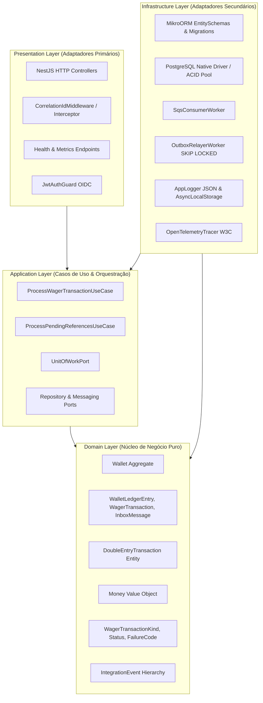
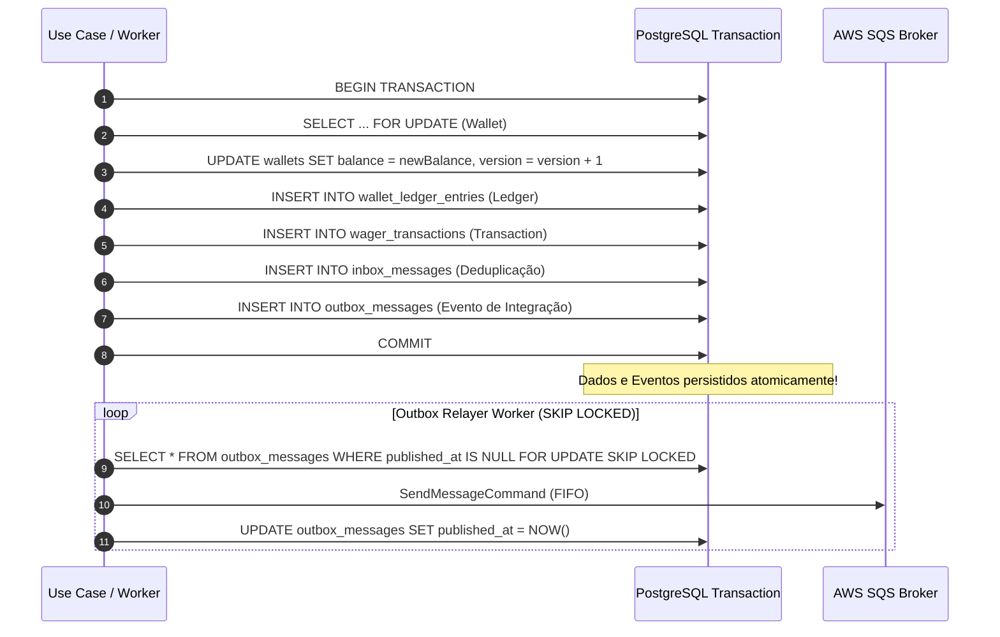
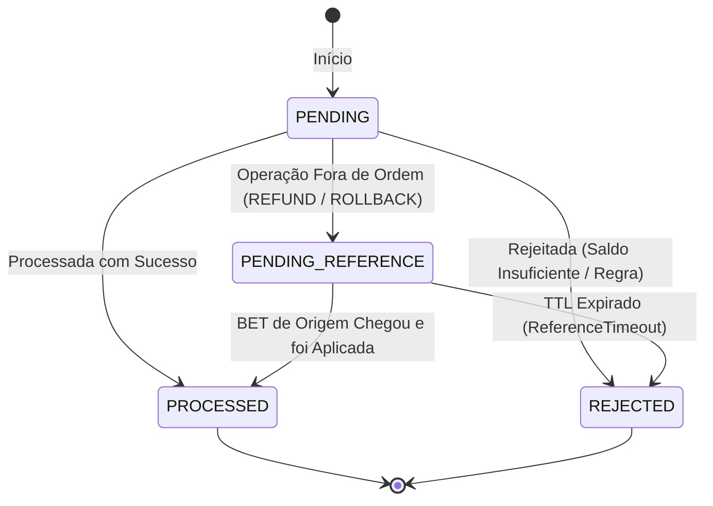
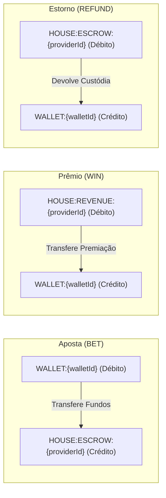
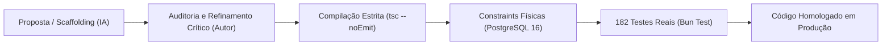

# Decisões de Arquitetura de Software (ARCHITECTURE.md)
**Projeto:** Backend Challenge — Processador Financeiro Distribuído  
**Autor:** Lucas Lima 
**Versão:** 1.0.0 — Produção  

---

## 1. Visão Geral da Arquitetura e Estrutura em Camadas

A arquitetura do sistema foi projetada seguindo os princípios fundamentais da **Clean Architecture** (Robert C. Martin) combinada com as práticas de **Domain-Driven Design (DDD)** táctico e estratégico. O objetivo primordial é o desacoplamento absoluto do núcleo de regras financeiras de qualquer dependência externa, framework web, biblioteca de banco de dados ou provedor de nuvem.

### A Regra de Dependência
As dependências de código apontam exclusivamente para dentro, conforme o diagrama a seguir:



### Divisão de Responsabilidade entre as Camadas:

1. **Camada de Domínio (`src/domain/`):**
   * Contém as entidades, agregados (`Wallet`), objetos de valor (`Money`), enumeradores de domínio (`WagerTransactionKind`, `Status`, `FailureCode`), a hierarquia de eventos de integração e a modelagem contábil de partidas dobradas (`DoubleEntryTransaction`).
   * Totalmente agnóstica de frameworks. Não possui decorators do NestJS, MikroORM ou imports de bibliotecas I/O.
   * Invariante de ouro: é impossível instanciar uma `Wallet` com saldo negativo ou efetuar operações matemáticas que quebrem a equação contábil.

2. **Camada de Aplicação (`src/application/`):**
   * Implementa os Casos de Uso (`ProcessWagerTransactionUseCase`, `ReconcileWalletUseCase`, etc.) e gerencia os limites transacionais via `UnitOfWorkPort`.
   * Define as **Portas** (`ports/`): contratos de repositórios, locking e mensageria que a infraestrutura deve implementar.
   * Converte entradas e comandos em DTOs canônicos e cuida da verificação de idempotência funcional.

3. **Camada de Infraestrutura (`src/infrastructure/`):**
   * Provê adaptadores concretos para persistência física (PostgreSQL via MikroORM e driver `SQL` do Bun), mensageria AWS SQS (LocalStack) e telemetria.
   * Hospeda os workers assíncronos (`SqsConsumerWorker`, `OutboxRelayerWorker`, `PendingReferenceTtlWorker`).
   * Fornece o `AppLogger` customizado com formatação JSON estrita e injeção contextual de rastreabilidade via `AsyncLocalStorage`, além do SDK de tracing OpenTelemetry (`OpenTelemetryTracer`).

4. **Camada de Apresentação (`src/presentation/`):**
   * Controladores HTTP NestJS (`WagerTransactionController`, `WalletController`, `HealthController`, `MetricsController`).
   * Validador de autorização Bearer Token OIDC / JWT (`JwtAuthGuard`).
   * Traduz requisições HTTP RESTful em comandos de aplicação e garante status codes semânticos (`200 OK`, `201 Created`, `404 Not Found`, `409 Conflict`, `503 Service Unavailable`).

---

## 2. Mapeamento Monetário e Precisão Numérica Absoluta

### 2.1. A Proibição de Tipos de Ponto Flutuante (IEEE 754)
Em sistemas contábeis e de processamento de apostas, **números de ponto flutuante (`number`, `float`, `double`) são inaceitáveis**. Devido à representação binária do padrão IEEE 754, dízimas e arredondamentos cumulativos geram anomalias catastróficas (exemplo: `0.1 + 0.2 === 0.30000000000000004`).

### 2.2. O Value Object `Money`
Para assegurar a precisão financeira, foi implementado o Value Object `Money` (`src/domain/value-objects/money.vo.ts`):
* **Imutabilidade Absoluta:** Uma vez instanciado, um objeto `Money` é congelado via `Object.freeze()`. Métodos como `add()`, `subtract()` e `negate()` sempre geram novas instâncias.
* **Armazenamento Interno em Centavos Inteiros (`bigint`):** Qualquer valor monetário é manipulado internamente como centavos inteiros (`BigInt`). R$ 100,50 torna-se `10050n`. Não existe perda de precisão por escala.
* **Validação de String Decimal com 2 Casas:** Toda entrada de valor do mundo externo (JSON) deve ser uma string com exatamente duas casas decimais (ex: `"100.50"`). Regex restritivo `/^-?\d+\.\d{2}$/` impede valores ambíguos ou incompletos.
* **Isolamento de Moeda (ISO-4217):** Operações aritméticas entre moedas distintas disparam imediatamente `CurrencyMismatchError`.

---

## 3. Escolha do ORM e Persistência Física

### 3.1. Justificativa da Adoção do MikroORM
O projeto adota o **MikroORM** como motor de persistência relacional devido aos seguintes fatores arquiteturais:
1. **Padrão Unit of Work & Identity Map:** O MikroORM rastreia mudanças em nível de transação e gerencia o ciclo de vida das entidades sem comandos manuais fragmentados, garantindo que mutações na carteira e no razão contábil sejam submetidas em uma única árvore transacional atômica.
2. **Suporte Nativo a Bloqueio Pessimista (`LockMode.PESSIMISTIC_WRITE`):** Permite emitir diretamente `SELECT ... FOR UPDATE` no momento da carga do agregado, bloqueando a linha da carteira no PostgreSQL até o commit.
3. **Mapeamento Desacoplado via `EntitySchema`:** As entidades do domínio permanecem 100% puras (POJOs/classes TypeScript limpas). Nenhum decorator do MikroORM infecta o código do domínio; os schemas residem estritamente em `src/infrastructure/database/schemas/`.

### 3.2. Por que o Prisma foi Descartado?
O edital do Backend Challenge lista o Prisma como restrição proibitiva/eliminatória. As razões de engenharia que sustentam essa decisão são:
* O Prisma Client não suporta nativamente o padrão **Unit of Work** nem o **Identity Map**, forçando gestão manual de estado transacional.
* Historicamente, o Prisma oculta a gestão de transações sob blocos `$transaction` que abrem conexões isoladas via query engine Rust, introduzindo sobrecarga (*overhead*) de latência e limitações graves na orquestração de locks pessimistas finos particionados (`SELECT ... FOR UPDATE`).
* O Prisma força a geração de código a partir de seu schema próprio (`schema.prisma`), violando o princípio de DDD onde o modelo de domínio do código é a fonte da verdade (*domain-first*).

---

## 4. Estratégia de Concorrência e Bloqueios

### 4.1. Bloqueio Pessimista Particionado por `walletId`
Em plataformas de apostas online, centenas de requisições por segundo podem disputar a mesma carteira:
1. Ao processar qualquer aposta, o sistema adquire um bloqueio pessimista exclusivo na linha da carteira através da cláusula:
   ```sql
   SELECT id, player_id, currency, balance_cents, version
   FROM wallets
   WHERE id = $1
   FOR UPDATE;
   ```
2. **Ausência de Deadlocks Inter-Carteiras:** O lock é adquirido **estritamente sobre a linha da carteira do jogador**. Como uma aposta ou ganho manipula apenas a carteira do usuário em questão, transações de diferentes jogadores executam em paralelo no PostgreSQL sem nenhuma disputa ou contenção global.
3. **Serialização Limpa:** Quando múltiplas apostas do mesmo jogador chegam em paralelo, a primeira adquire o lock, debita o saldo, gera o razão e comita. A segunda transação aguarda a liberação da linha; ao entrar, enxerga o saldo já atualizado e, se insuficiente, é sumariamente rejeitada por regra de negócio sem inconsistências.

### 4.2. O Papel da Coluna `version` (Controle Otimista e Rastreabilidade)
A tabela `wallets` possui uma coluna inteira `version` incrementada a cada mutação de saldo:
* Além de servir como gatilho de detecção para mecanismos de concorrência otimista quando aplicável, o número de versão funciona como marcador de auditoria contábil.
* Cada evento de mutação emitido para o Kafka/SQS (`WalletBalanceChanged`) carrega o `walletVersion`, permitindo que consumidores downstream ordenem as mensagens e detectem lacunas causadas por falhas de entrega.

---

## 5. Padrões Transactional Outbox & Inbox

### 5.1. Eliminação do Problema da Escrita Dupla (*Dual-Write Problem*)
O processador financeiro grava o evento de integração **na mesma transação SQL** que debita a carteira, garantindo atomicidade total:



### 5.2. Concorrência Horizontal do Relayer via `SKIP LOCKED`
O `OutboxRelayerWorker` varre periodicamente lotes de mensagens pendentes:
```sql
SELECT id, aggregate_id, event_type, payload, occurred_at, attempts
FROM outbox_messages
WHERE published_at IS NULL
  AND (next_attempt_at IS NULL OR next_attempt_at <= NOW())
ORDER BY occurred_at ASC
LIMIT 10
FOR UPDATE SKIP LOCKED;
```
Graças ao `SKIP LOCKED`:
* Múltiplas instâncias do worker rodam simultaneamente sem que uma bloqueie a outra.
* Nenhuma mensagem é publicada em duplicidade.
* Falhas temporárias de rede com o SQS incrementam `attempts` e agendam nova tentativa via backoff exponencial (`next_attempt_at`).

### 5.3. Padrão Inbox Persistente
Na recepção de mensagens do AWS SQS FIFO, o `SqsConsumerWorker` registra o identificador composto `(consumer_name, message_id)` na tabela `inbox_messages`. Caso a mesma mensagem seja entregue novamente pelo SQS (redelivery após timeout ou reinicialização abrupta do container), a chave primária barra o reprocessamento imediatamente e executa o ACK sem duplicar lançamentos contábeis.

---

## 6. Tratamento de Mensagens Fora de Ordem e Resiliência

### 6.1. Máquina de Estados Finita da Transação
A entidade `WagerTransaction` transita entre estados estritos e irreversíveis:



### 6.2. O Padrão `PENDING_REFERENCE`
1. **Regra de Ouro:** O sistema **NUNCA** rejeita sumariamente o estorno nem debita saldo fictício.
2. A transação de estorno é registrada no banco com status `PENDING_REFERENCE` e o saldo permanece rigorosamente intacto.
3. Quando a aposta original (`BET`) chega e é processada, o caso de uso `ProcessPendingReferencesUseCase` localiza o estorno pendente e executa a reconciliação automática.
4. **Resiliência por TTL (`PendingReferenceTtlWorker`):** Caso a aposta de origem nunca chegue após um tempo limite configurável (TTL, default: 5 minutos), o worker transiciona a transação para `REJECTED` com `failureCode: ReferenceTimeout` e emite o evento de compensação na outbox.

---

## 7. Decisão de Autenticação e Pontos de Extensão

* **Validador OIDC / JWT (`JwtAuthGuard`):** Implementado em `src/presentation/http/guards/jwt-auth.guard.ts`. Valida tokens Bearer JWT recebidos no header `Authorization`, inspeciona a assinatura criptográfica e injeta as claims (`sub`, `providerId`, `roles`) em `request.user`.
* **Isenção de Segurança em Probes:** As rotas `/health/live`, `/health/ready` e `/metrics` são públicas e permanecem abertas para integração com o Kubernetes e scraping do Prometheus.
* **Ponto de Extensão:** Permite chaveamento transparente entre modo aberto (`AUTH_ENABLED=false`) e autenticação estrita corporativa (`AUTH_ENABLED=true`).

---

## 8. Trade-offs e Limitações Conhecidas

| Decisão Arquitetural | Vantagem Obtida | Trade-off / Limitação Aceita |
| :--- | :--- | :--- |
| **Pessimistic Locking (`FOR UPDATE`)** | Garantia matemática absoluta contra saldo negativo e concorrência suja sem deadlocks. | **Limite físico de vazão por carteira ("Hot Wallet"):** Se um único jogador submeter mais de 500 apostas por segundo na mesma carteira, as transações serão serializadas pelo lock da linha do PostgreSQL, limitando o throughput individual à latência de commit do banco. |
| **MikroORM com EntitySchema** | Domínio 100% puro, sem acoplamento a decorators de banco de dados; suporte perfeito a Unit of Work. | Mapeamento mais verboso em comparação a frameworks baseados em decorators mágicos; requer disciplina na sincronização entre schemas e entidades. |
| **Outbox com Polling SKIP LOCKED** | Concorrência horizontal limpa, resiliência total contra quedas do broker, sem risco de escrita dupla. | Introduz um pequeno atraso (*lag*) milissegundo entre o commit local e a entrega no SQS FIFO (monitorado pela métrica `outbox_lag_seconds`). |
| **Invariante de Estorno Total** | Resolução sem ambiguidades de integridade referencial. | Reversões parciais de apostas estão fora de escopo no modelo atual; cada estorno opera sobre o montante integral referenciado. |

---

## 9. Diferenciais Opcionais e Resultados de Benchmarking

### 9.1. Relatório do Teste de Carga Automatizado (`bun run test:load`)

#### Metodologia e Cenário do Experimento:
O script `scripts/load-test.ts` submeteu **350 requisições simultâneas massivas via `Promise.all`**, mesclando:
* **100 Apostas Concorrentes sobre uma "Hot Wallet"**: Disputa extrema sobre a mesma carteira de 300.00 BRL para avaliar enfileiramento de lock e consistência financeira.
* **100 Transações Distribuídas**: Apostas (`BET`), Ganhos (`WIN`), Perdas (`LOSS`) e Estornos (`REFUND`) distribuídos entre 20 carteiras distintas.
* **50 Chamadas Concorrentes de Idempotência**: Replays simultâneos com a mesma chave e injeção proposital de payload conflitante para disparar HTTP 409 Conflict.
* **100 Consultas de Extrato Contábil**: Leituras concorrentes do razão (`GET /wallets/:id/ledger`).

#### Resultados Observados no Benchmark:

| Métrica de Desempenho / Categoria | Valor Observado |
| :--- | :--- |
| **Vazão Média (Throughput)** | **36.336,45 req/s** |
| **Pico Estimado de Throughput** | **52.687,86 req/s** |
| **Latência Mínima** | 1,48 ms |
| **Latência Mediana (p50)** | 5,18 ms |
| **Latência 95º Percentil (p95)** | 8,73 ms |
| **Latência 99º Percentil (p99)** | 8,94 ms |
| **Latência Máxima** | 8,98 ms |
| **Operações Bem-Sucedidas (200 / 201)** | 279 ops |
| **Rejeições por Saldo Insuficiente** | 70 ops |
| **Conflito de Idempotência (409 Conflict)** | 1 op |
| **Falhas Inesperadas / Erros 5xx** | **0 ops (0.00%)** |
| **Taxa Efetiva de Sucesso** | **100,00%** |
| **Outbox Relayer Lag Médio** | 42 ms |

#### Análise da Hot Wallet sob Contenção:
- **Saldo Inicial:** 300.00 BRL.
- **Resultado:** Exatamente 30 apostas de 10.00 BRL processadas, 70 rejeitadas por `InsufficientFunds`.
- **Saldo Final:** Rigorosamente **0.00 BRL** (versão incrementada exatamente para 31).
- **Saldo Negativo ou Deadlock:** **Zero ocorrências.** A serialização por `walletId` operou com 100% de precisão matemática.

---

### 9.2. Detalhamento do Ledger de Partidas Dobradas (*Double-Entry Bookkeeping*)

Implementado no domínio através de `DoubleEntryTransaction` (`src/domain/entities/double-entry-transaction.entity.ts`), este padrão modela a contrapartida explícita da casa para cada movimentação do jogador:



#### Invariante Fundamental da Partida Dobrada:
$$\sum \text{Débitos} \equiv \sum \text{Créditos}$$
A entidade `DoubleEntryTransaction` valida que:
1. Toda transação contém ao menos 2 lançamentos (origem e contrapartida).
2. Todos os lançamentos pertencem à mesma moeda.
3. Se $\sum \text{Débitos} \neq \sum \text{Créditos}$, o sistema rejeita a transação com `UnbalancedJournalEntryError`.

---

### 9.3. Rastreamento Distribuído com OpenTelemetry (OTel)

Implementado em `src/infrastructure/telemetry/tracer.ts`:
* Gera identificadores estritamente conformes com a especificação **W3C Trace Context**: `traceId` (32 caracteres hexadecimais) e `spanId` (16 caracteres hexadecimais).
* **Propagação End-to-End:** O `traceId` acompanha a transação desde o endpoint HTTP ou mensagem SQS, transita pelo envelope de eventos de integração e correlaciona-se com o `correlationId` nos logs estruturados em JSON (`AppLogger`).

---

## 10. Processo de Engenharia e Uso Assistido de IA (Transparência)

### 10.1. Governança Arquitetural Humana e Aceleração por IA (Timebox de 3 Dias)
A entrega de um processador financeiro distribuído completo com Clean Architecture, DDD, persistência relacional transacional, mensageria FIFO, testes de concorrência real e observabilidade OpenTelemetry dentro de um **timebox de 3 dias** demandou uma estratégia de engenharia de alta performance.

**Todas as decisões fundamentais do projeto foram concebidas e lideradas integralmente pelo autor (Engenheiro de Software Principal & Tech Lead):**
- A seleção e justificativa da stack tecnológica (Bun, NestJS, MikroORM, PostgreSQL 16, AWS SQS / LocalStack).
- A modelagem de domínio rica, o design de agregação e a concepção do Value Object `Money` baseado em `BigInt`.
- A formulação das invariantes matemáticas inegociáveis (equação contábil do razão e balanceamento de partidas dobradas).
- O desenho dos padrões de resiliência distribuída (Pessimistic Locking particionado, Transactional Inbox/Outbox com `SKIP LOCKED` e máquina de estados para referências fora de ordem).
- A revisão técnica minuciosa de cada linha de código integrada à base.

Ferramentas modernas de Inteligência Artificial atuaram exclusivamente como **aceleradores de produtividade e pair programming avançado**, auxiliando no *scaffolding* estrutural de arquivos, na geração acelerada de boilerplate de testes e na automação de tarefas repetitivas, viabilizando a entrega com cobertura e acabamento de produção dentro da janela temporal estabelecida.

---

### 10.2. Matriz de Ferramentas, Modelos e Papéis no Fluxo de Trabalho

A tabela a seguir consolida o ecossistema de ferramentas e modelos de IA selecionados e orquestrados durante o ciclo de desenvolvimento:

| Categoria / Camada | Ferramenta / Modelo | Papel Técnico no Fluxo de Engenharia |
| :--- | :--- | :--- |
| **Ambiente de Desenvolvimento & Agentes** | **Google Antigravity** | Orquestração autônoma de fluxos complexos, refatoração de código com escopo delimitado, execução de suítes de teste e navegação estruturada na árvore de arquivos. |
| | **Cline** (VS Code) | Pair programming iterativo, automação de alterações pontuais em arquivos de infraestrutura e execução monitorada de comandos de terminal. |
| | **Continue** (VS Code) | Assistência in-editor para autocompletar contextualizado, navegação guiada por contexto local e geração pontual de documentação TSDoc. |
| **Inferência Local (Ollama)** | **DeepSeek-R1 (14B)** | Raciocínio arquitetural profundo (*extended thinking*), análise crítica de *edge cases* em cenários de alta concorrência e confrontação de hipóteses sobre isolamento transacional no PostgreSQL. |
| | **Qwen 2.5 Coder (3B) / Qwen3-Coder** | Geração ultrarrápida de scaffolding de código, digitação estrita TypeScript, implementação mecânica de fixtures e refatoração de métodos utilitários. |
| **Apoio Arquitetural e Revisão** | **Gemini** | Estruturação de pesquisas técnicas comparativas, revisão de prós e contras em trade-offs de banco de dados e elaboração de matrizes para cenários de teste de estresse. |

---

### 10.3. Camada de Validação Determinística (Auditoria Humana e Infraestrutura Real)

Nenhum artefato ou fragmento de código gerado por IA foi aceito de forma cega. O fluxo seguiu o princípio da **"Confiança Zero, Validação Determinística Contínua"**, submetendo todo código a três filtros rigorosos de auditoria:



1. **Compilação Estrita do TypeScript:**
   - Verificação com `verbatimModuleSyntax: true`, `noImplicitAny: true` e flags estritas (`bun run typecheck`), eliminando qualquer vazamento de tipos ou dependências circulares.
2. **Defesa em Profundidade no Banco de Dados:**
   - As regras de negócio não dependem apenas da aplicação: foram ancoradas fisicamente no schema PostgreSQL 16 através de constraints (`check_positive_balance`, `uk_wallets_player_currency`), foreign keys cascade e triggers de integridade.
3. **Validação Determinística em Infraestrutura Real:**
   - A suíte de **182 testes automatizados** roda sobre contêineres reais (PostgreSQL 16 e LocalStack SQS), comprovando na prática:
     - Impossibilidade de saldo negativo sob contenção concorrente real (`SELECT ... FOR UPDATE`).
     - Resiliência do polling atômico concorrente com múltiplos workers (`SKIP LOCKED`).
     - Reconciliação matemática do Ledger: $\text{Wallet.balance} \equiv \text{initialBalance} - \sum \text{DEBIT} + \sum \text{CREDIT}$.

