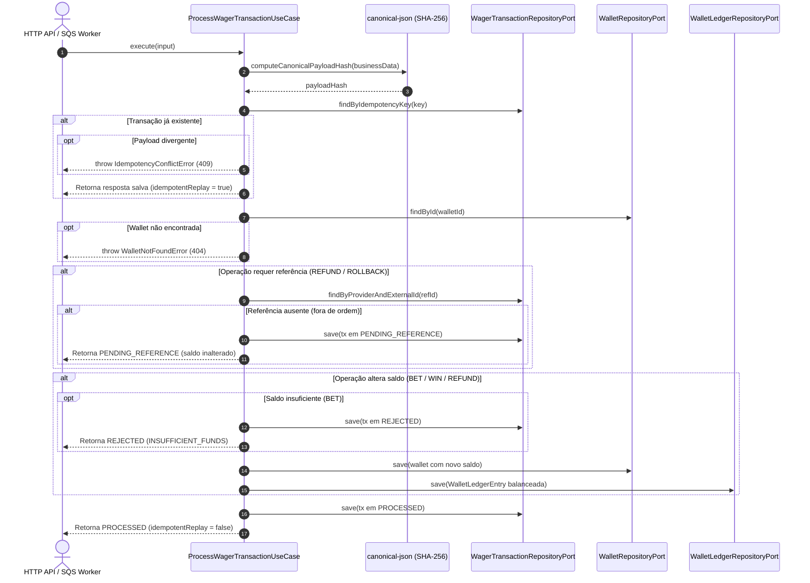

# Módulo: Camada de Aplicação (`src/application`)

---

## SEÇÃO 1: ENGENHARIA DE SOFTWARE (Technical Specification)

### 1. Visão Geral e Responsabilidade
O módulo de Aplicação orquestra os casos de uso do sistema financeiro distribuído, intermediando as requisições recebidas (via API HTTP ou fila SQS) e as entidades do Domínio. Sua responsabilidade única é coordenar a persistência, garantir a idempotência estrita de operações financeiras, gerenciar mensagens assíncronas fora de ordem (Padrão Inbox) e registrar de forma atômica movimentações no razão (`WalletLedgerEntry`).

### 2. Motivação e Justificativa (Por que existe?)
Em ambientes distribuídos com múltiplos provedores de jogos e entrega de mensagens *at-least-once*:
* Mensagens de apostas e estornos podem chegar duplicadas ou reordenadas na rede.
* Provedores podem reenviar a mesma `Idempotency-Key` com dados divergentes (tentativa de fraude ou replay corrompido).
* O estorno (`REFUND`) pode ser entregue pelo broker antes da aposta original (`BET`).

#### Invariantes e Garantias Asseguradas:
* **Idempotência Persistente Determinística**: 
  - Requisição com mesma `Idempotency-Key` e payload idêntico $\rightarrow$ Retorna o resultado original salvo sem reprocessar saldo (`idempotentReplay: true`).
  - Requisição com mesma `Idempotency-Key` e payload diferente $\rightarrow$ Dispara imediatamente `IdempotencyConflictError` (HTTP 409 Conflict).
* **Tratamento de Mensagens Fora de Ordem (Inbox / PENDING_REFERENCE)**:
  - Se um `REFUND` ou `ROLLBACK` referencia uma aposta ainda não registrada no banco, a transação é gravada como `PENDING_REFERENCE`. O saldo e o ledger permanecem estritamente intactos para resolução assíncrona futura.
* **Atomicidade Contábil**:
  - Para cada débito (`BET`) ou crédito (`WIN`, `REFUND`), 1 registro no ledger é gerado e associado à wallet e à transação.
  - Operações sem efeito monetário (`LOSS`) e transações rejeitadas (`REJECTED`) não produzem lançamentos no ledger.

### 3. Detalhamento Técnico da Implementação

#### Componentes do Módulo
| Componente | Tipo | Responsabilidade |
|---|---|---|
| `ProcessWagerTransactionUseCase` | Use Case | Orquestra a execução da transação de aposta, reconciliação de saldo, idempotência e ledger. |
| `WalletRepositoryPort` | Interface (Port) | Contrato de persistência e recuperação do agregado `Wallet`. |
| `WagerTransactionRepositoryPort` | Interface (Port) | Contrato de persistência e busca de `WagerTransaction` por ID, Idempotency-Key e par (providerId, externalId). |
| `WalletLedgerRepositoryPort` | Interface (Port) | Contrato de persistência para as entradas imutáveis de ledger. |
| `computeCanonicalPayloadHash` | Utility | Serializa o payload em JSON canônico (com ordenação alfabética recursiva de chaves) e calcula o hash SHA-256 estável. |
| `IdempotencyConflictError` | Custom Error | Sinaliza conflito quando uma chave de idempotência é reutilizada com payload divergente. |
| `WalletNotFoundError` | Custom Error | Sinaliza ausência da carteira indicada na requisição. |

#### Diagrama de Sequência do Caso de Uso


### 4. Alinhamento com Clean Architecture & DDD
* **Camada**: `Application Layer` (`src/application/`).
* **Princípio da Inversão de Dependência (DIP)**: O caso de uso depende exclusivamente de **Portas** (`Ports` / Interfaces TypeScript), nunca de implementações concretas de banco de dados (ex: MikroORM, TypeORM, Postgres).
* **Testabilidade**: Permite testes unitários e de integração leve instantâneos (30ms) utilizando mocks ou repositórios em memória.

---

## SEÇÃO 2: USER GUIDE & MANUAL DE OPERAÇÃO

### 1. Como Executar e Testar
A suíte de testes de aplicação roda integralmente no Bun sem depender de infraestrutura externa:

```bash
# Executa os testes de caso de uso
bun test tests/application/use-cases/

# Executa toda a suíte de testes do projeto com cobertura
bun test --coverage
```

### 2. Exemplo de Uso Prático

```ts
import { 
  ProcessWagerTransactionUseCase, 
  WagerTransactionKind 
} from "./src/application";

// Instanciação com as portas de repositório injetadas
const useCase = new ProcessWagerTransactionUseCase(
  walletRepository,
  wagerTransactionRepository,
  walletLedgerRepository
);

// Execução de uma aposta (BET)
const result = await useCase.execute({
  idempotencyKey: "evolution:bet-9988",
  providerId: "evolution",
  externalTransactionId: "bet-9988",
  playerId: "player-uuid-1",
  walletId: "wallet-uuid-1",
  roundId: "round-10",
  gameId: "lightning-roulette",
  kind: WagerTransactionKind.Bet,
  money: { amount: "50.00", currency: "BRL" }
});

console.log(result);
// {
//   transactionId: "...",
//   status: "PROCESSED",
//   balance: { amount: "150.00", currency: "BRL" },
//   idempotentReplay: false
// }
```

### 3. Guia de Resolução de Problemas (Troubleshooting)

| Erro / Situação | Significado | Como Tratar |
|---|---|---|
| `IdempotencyConflictError` | A mesma chave `Idempotency-Key` foi enviada previamente com um corpo de requisição diferente. | Responder com HTTP 409 Conflict. O cliente deve gerar uma nova chave única ou corrigir o payload duplicado. |
| `WalletNotFoundError` | O `walletId` informado na requisição não foi encontrado na base de dados. | Responder com HTTP 404 Not Found. Verificar se a carteira foi aberta previamente via `POST /wallets`. |
| Resposta com `status: PENDING_REFERENCE` | Operação de `REFUND` ou `ROLLBACK` recebida antes da `BET` original. | Aceitar a requisição (HTTP 200/202). Um worker agendado resolverá a transação assim que a mensagem referenciada chegar. |
| Resposta com `status: REJECTED` (`INSUFFICIENT_FUNDS`) | Aposta negada porque a carteira não possui saldo suficiente para o débito. | Informar ao provedor que a aposta foi recusada por falta de fundos. Não retentar com a mesma aposta sem recarga de saldo. |
