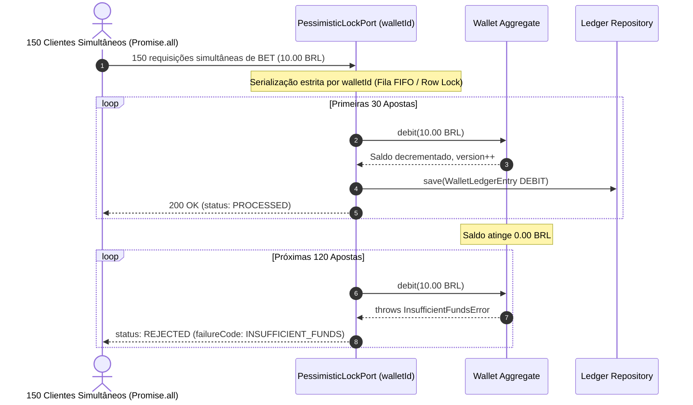

# Módulo: Testes de Estresse, Concorrência e Invariantes Matemáticas (`test/e2e/concurrency.spec.ts`)

---

## SEÇÃO 1: ENGENHARIA DE SOFTWARE (Technical Specification)

### 1. Visão Geral e Responsabilidade
O módulo de testes E2E de concorrência valida a integridade comportamental, ausência de deadlocks e consistência financeira do processador de apostas quando submetido a disparos paralelos massivos simultâneos (`Promise.all`). Sua responsabilidade é comprovar que requisições concorrentes sobre a mesma carteira não causam *lost updates*, não geram saldo negativo e mantêm a invariante matemática estrita de reconciliação contábil.

### 2. Motivação e Justificativa (Por que existe?)
Em plataformas de cassino online (*iGaming*), centenas de rodadas e apostas simultâneas disputam o saldo da mesma carteira no mesmo milissegundo:
* Se duas ou mais requisições lerem o saldo simultaneamente antes de debitar (leitura suja/concorrente desprotegida), ambas autorizam a aposta, levando a carteira a saldo negativo ou corrompendo a contabilidade.
* O sistema deve garantir que o bloqueio pessimista (`Pessimistic Locking` / `SELECT ... FOR UPDATE`) serialize as transações por `walletId` sem causar deadlocks e rejeite as apostas excedentes assim que o saldo se esgotar.

#### Invariantes e Propriedades Comprovadas:
* **Prevenção de Lost Update & Saldo Negativo**:
  - Em um lote de 150 apostas simultâneas de 10.00 BRL disputando uma carteira com saldo inicial de 300.00 BRL:
    - Exatamente **30 apostas** são processadas (`PROCESSED`), consumindo os 300.00 BRL e zerando o saldo.
    - Exatamente **120 apostas** são rejeitadas (`REJECTED`) por saldo insuficiente (`INSUFFICIENT_FUNDS`).
    - Nenhuma aposta excedente é autorizada e a carteira nunca fica com saldo negativo.
* **Invariante Matemática Absoluta do Ledger**:
  $$\text{Wallet.balance} \equiv \text{initialBalance} - \sum_{\text{DEBIT}} \text{Ledger.money} + \sum_{\text{CREDIT}} \text{Ledger.money}$$
  O saldo materializado na carteira é comprovadamente idêntico ao saldo reconstruído a partir do somatório de lançamentos no razão.
* **Integridade de Versão Otimista**:
  - A versão da carteira é incrementada exatamente 30 vezes (de 1 para 31), correspondendo estritamente às 30 movimentações de saldo bem-sucedidas.

### 3. Detalhamento Técnico da Implementação

#### Componentes Envolvidos no Teste
| Componente | Tipo | Papel na Concorrência |
|---|---|---|
| `MemoryPessimisticLockAdapter` | Locking Adapter | Coordena o lock serializado por `walletId` em memória via encadeamento de Promises, espelhando `SELECT ... FOR UPDATE`. |
| `ProcessWagerTransactionUseCase` | Use Case | Orquestra a execução da aposta sob o bloqueio pessimista. |
| `Wallet` | Aggregate Root | Valida que `balance >= amount` e aplica o decremento atômico de saldo com incremento de `version`. |
| `WalletLedgerEntry` | Entity | Registra o lançamento balanceado (`balanceBefore - money === balanceAfter`). |
| `PostgresTestHelper` | Database Helper | Permite executar o mesmo teste de concorrência com queries reais `SELECT ... FOR UPDATE` no PostgreSQL Docker. |

#### Fluxo de Execução Concorrente


### 4. Alinhamento com Clean Architecture & DDD
* **Camada**: `E2E Test Layer` (`test/e2e/`).
* **Desacoplamento de Concorrência**: A porta `PessimisticLockPort` isola o caso de uso da tecnologia física de bloqueio (seja PostgreSQL `SELECT ... FOR UPDATE`, Redis Redlock ou `MemoryPessimisticLockAdapter`), permitindo que a mesma regra de negócio seja testada e operada de forma determinística.

---

## SEÇÃO 2: USER GUIDE & MANUAL DE OPERAÇÃO

### 1. Como Executar e Testar

```bash
# Executa apenas o teste de estresse e concorrência E2E
bun test test/e2e/concurrency.spec.ts

# Executa todos os testes do projeto (Unitários, Integração e E2E)
bun test
```

Para validar a concorrência diretamente contra o banco de dados PostgreSQL real no contêiner:

```bash
# Sobe o banco de dados
docker compose up -d

# Executa o teste contra o PostgreSQL ativo
bun test test/e2e/concurrency.spec.ts
```

### 2. Exemplo de Asserção da Invariante Matemática

```ts
// Verificação pós-estresse
const finalWallet = await walletRepo.findById(walletId);
const ledgerEntries = await ledgerRepo.findByWalletId(walletId);

// 1. Somatório de débitos registrados no ledger
let totalDebits = Money.zero("BRL");
for (const entry of ledgerEntries) {
  expect(entry.direction).toBe(LedgerDirection.Debit);
  totalDebits = totalDebits.add(entry.money);
}

// 2. Reconstrução contábil: initialBalance - sum(debits)
const reconstructedBalance = initialBalance.subtract(totalDebits);

// 3. Validação da Invariante: Saldo da carteira DEVE ser idêntico ao reconstruído
expect(reconstructedBalance.equals(finalWallet.balance)).toBe(true);
expect(finalWallet.balance.amount).toBe("0.00");
```

### 3. Guia de Resolução de Problemas (Troubleshooting)

| Sintoma Observado | Causa Raiz | Como Corrigir |
|---|---|---|
| Mais de 30 apostas processadas (saldo negativo na carteira) | Ausência ou falha no mecanismo de bloqueio pessimista por `walletId`. | Certificar-se de que o caso de uso ou repositório utiliza `PessimisticLockPort` ou query `SELECT ... FOR UPDATE`. |
| Menos de 30 apostas processadas com saldo restante | Rejeição indevida ou deadlock entre requisições. | Verificar o tratamento de timeout do lock e garantir que a fila por `walletId` libere a chave no bloco `finally`. |
| Quantidade de lançamentos no ledger diferente de 30 | Gravação de ledger ocorrendo fora da transação ou para apostas rejeitadas. | Garantir que o `WalletLedgerEntry` só seja criado quando a aposta for efetivamente debitada da carteira. |
