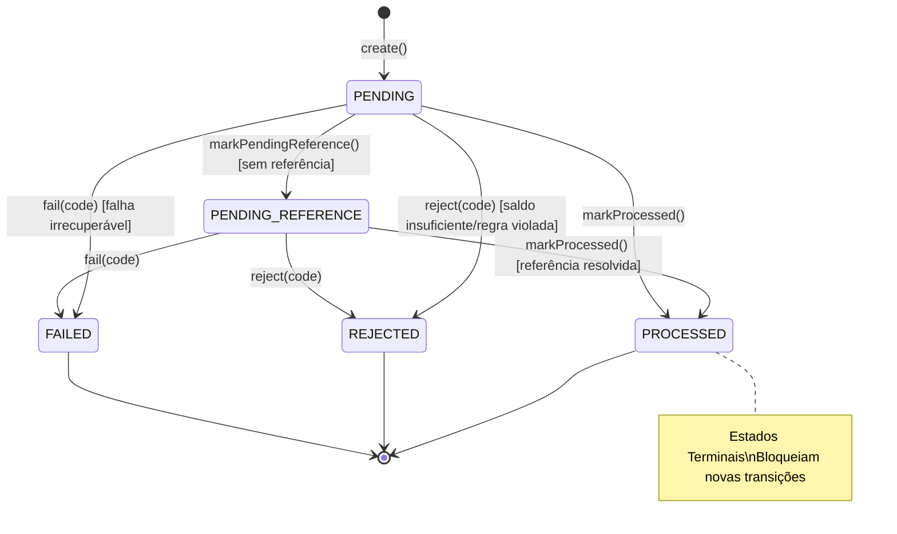

# Módulo: Camada de Domínio (`src/domain`)

---

## SEÇÃO 1: ENGENHARIA DE SOFTWARE (Technical Specification)

### 1. Visão Geral e Responsabilidade

O módulo de Domínio encapsula as regras centrais de negócio, invariantes financeiras e modelos comportamentais do processador distribuído de apostas (_Distributed Wagering Processor_). Ele é estritamente isolado de dependências externas (frameworks, ORM, bancos de dados ou transporte de rede), garantindo conformidade com Clean Architecture e Domain-Driven Design (DDD).

### 2. Motivação e Justificativa (Por que existe?)

Em sistemas iGaming e processadores de pagamentos distribuídos, pequenos desvios de precisão, condições de corrida ou inconsistências de saldo geram passivos financeiros irreversíveis.

#### Problemas Resolvidos & Invariantes Garantidas:

- **Precisão Monetária Sem Ponto Flutuante**: O IEEE 754 (`number`/`float`) gera imprecisões decimais clássicas (ex: `0.1 + 0.2 = 0.30000000000000004`). O domínio adota escala fixa de 2 casas representada em `bigint` (centavos inteiros).
- **Impedimento Absoluto de Saldo Negativo**: A carteira rejeita qualquer tentativa de débito que supere o saldo disponível.
- **Consistência Contábil Estrita**: Todo crédito ou débito que altere o saldo gera obrigatoriamente um registro no livro-razão (`WalletLedgerEntry`) onde `balanceBefore ± money === balanceAfter`. Transações sem movimentação financeira (`LOSS`) ou rejeitadas não geram lançamentos.
- **Integridade de Reversões**: Operações de estorno (`REFUND` e `ROLLBACK`) requerem validação cruzada rigorosa (mesmo provedor, jogador, carteira, rodada, moeda e valor exato da aposta referenciada). Reversões parciais são proibidas pelo modelo.
- **Máquina de Estados Finita e Imutabilidade Terminal**: Transições só ocorrem a partir de estados não terminais (`PENDING` ou `PENDING_REFERENCE`). Estados terminais (`PROCESSED`, `REJECTED`, `FAILED`) são invioláveis.

### 3. Detalhamento Técnico da Implementação

#### Componentes do Módulo

| Componente               | Tipo              | Responsabilidade                                                                                                              |
| ------------------------ | ----------------- | ----------------------------------------------------------------------------------------------------------------------------- |
| `Money`                  | Value Object      | Manipulação monetária imutável, validação de escala decimal fixa (2 casas), isolamento por moeda (ISO-4217).                  |
| `Wallet`                 | Aggregate Root    | Gerencia saldo, controle de versão otimista e autorização de débitos/créditos. Construtor protegido.                          |
| `WagerTransaction`       | Entity            | Ciclo de vida da aposta, cálculo de direção contábil e validação de referências (`BET`, `WIN`, `LOSS`, `REFUND`, `ROLLBACK`). |
| `WalletLedgerEntry`      | Entity (Imutável) | Registro imutável de auditoria contábil com verificação da equação `balanceBefore ± money === balanceAfter`.                  |
| `WagerTransactionKind`   | Enum              | Tipos de transação financeira e operacional (`OPENING`, `BET`, `WIN`, `LOSS`, `REFUND`, `ROLLBACK`).                          |
| `WagerTransactionStatus` | Enum              | Estados do ciclo de vida (`PENDING`, `PENDING_REFERENCE`, `PROCESSED`, `REJECTED`, `FAILED`).                                 |
| `LedgerDirection`        | Enum              | Direção do lançamento no razão financeiro (`DEBIT`, `CREDIT`).                                                                |
| `FailureCode`            | Enum              | Taxonomia padronizada de motivos de falha de negócio.                                                                         |

#### Fluxo Lógico de Transição de Estados



#### Tratamento de Erros de Domínio

- `InvalidMoneyError`: Disparado quando `amount` não é string, tem formato inválido, escala diferente de 2 casas decimais, `NaN`, `Infinity` ou notação científica.
- `CurrencyMismatchError`: Disparado quando moedas divergentes são combinadas em operações aritméticas ou transações financeiras.
- `InsufficientFundsError`: Disparado quando o débito excede o saldo da carteira.
- `InvalidTransactionStateError`: Disparado ao tentar transicionar uma entidade já em estado terminal (`PROCESSED`, `REJECTED`, `FAILED`).
- `InvalidTransactionOperationError`: Disparado quando regras de dependência entre transações são violadas (ex: `REFUND` tentando reverter um `WIN`, divergência de rodada ou valor).

### 4. Alinhamento com Clean Architecture & DDD

- **Camada**: `Domain Layer` (`src/domain/`).
- **Regra de Dependência**: Nenhuma importação de pacotes de banco de dados, NestJS ou mensageria. Apenas tipos padrão da linguagem e utilitários nativos.
- **Encapsulamento**: Construtores protegidos/privados obrigam a instanciação via factories semânticas (`open`, `create`, `from`, `rehydrate`).

---

## SEÇÃO 2: USER GUIDE & MANUAL DE OPERAÇÃO

### 1. Como Executar e Testar

Os testes unitários cobrem 100% das funções do domínio utilizando o test runner nativo do Bun sem dependências externas.

```bash
# Executa todos os testes unitários do domínio
bun test tests/domain/

# Executa com relatório de cobertura
bun test tests/domain/ --coverage
```

> [!NOTE]
> Nenhum contêiner Docker (PostgreSQL ou LocalStack) é necessário para a suíte de testes de domínio.

### 2. Exemplo de Uso Prático

```ts
import {
  Money,
  Wallet,
  WagerTransaction,
  WagerTransactionKind,
  WalletLedgerEntry,
  LedgerDirection,
} from "./src/domain";

// 1. Criação do Value Object Money
const initialAmount = Money.from({ amount: "200.00", currency: "BRL" });
const betAmount = Money.from({ amount: "50.00", currency: "BRL" });

// 2. Abertura da Wallet (versão inicial = 1)
const wallet = Wallet.open({
  id: "wallet-uuid-1",
  playerId: "player-uuid-1",
  initialBalance: initialAmount,
});

// 3. Criação da transação de aposta (BET)
const betTx = WagerTransaction.create({
  id: "tx-uuid-1",
  providerId: "pragmatic",
  externalTransactionId: "ext-101",
  idempotencyKey: "pragmatic:ext-101",
  payloadHash: "hash-sha256",
  walletId: wallet.id,
  playerId: wallet.playerId,
  roundId: "round-88",
  gameId: "sweet-bonanza",
  kind: WagerTransactionKind.Bet,
  money: betAmount,
});

// 4. Execução do débito e conciliação de ledger
const balanceBefore = wallet.balance;
wallet.debit(betTx.money); // Saldo atualizado para 150.00 BRL, versão = 2
const balanceAfter = wallet.balance;

const ledgerEntry = WalletLedgerEntry.create({
  id: "ledger-uuid-1",
  walletId: wallet.id,
  transactionId: betTx.id,
  direction: LedgerDirection.Debit,
  money: betTx.money,
  balanceBefore,
  balanceAfter,
});

betTx.markProcessed(undefined, new Date());
```

### 3. Guia de Resolução de Problemas (Troubleshooting)

| Erro Disparado                                                 | Causa Raiz Provável                                                                 | Como Resolver                                                                                         |
| -------------------------------------------------------------- | ----------------------------------------------------------------------------------- | ----------------------------------------------------------------------------------------------------- |
| `InvalidMoneyError: Amount must have exactly 2 decimal places` | Entrada formatada sem 2 casas (ex: `"100"` ou `"100.5"`).                           | Sempre fornecer strings decimais com 2 casas exatas (ex: `"100.00"`, `"100.50"`).                     |
| `InvalidMoneyError: Amount must be a string, received number`  | O payload transportou um número nativo JS em vez de string decimal.                 | Ajustar DTOs/contrato de entrada para enviar campos monetários como string (ex: `"amount": "25.00"`). |
| `CurrencyMismatchError`                                        | Tentativa de operar valores com moedas distintas (ex: BRL vs USD).                  | Certificar-se de que a moeda da transação corresponde rigorosamente à moeda da carteira.              |
| `InsufficientFundsError`                                       | Saldo insuficiente para cobrir o valor solicitado no `debit()`.                     | Rejeitar a transação na camada de aplicação com status `REJECTED` e `FailureCode.InsufficientFunds`.  |
| `InvalidTransactionStateError`                                 | Tentativa de alterar o estado de uma transação `PROCESSED`, `REJECTED` ou `FAILED`. | Tratar transações terminais como imutáveis; não reenviar comandos de transição de estado.             |
| `InvalidTransactionOperationError`                             | `REFUND` ou `ROLLBACK` com valor diferente ou tipo de referência inválido.          | Garantir que o valor estornado seja idêntico ao valor original e aposta referenciada seja válida.     |
