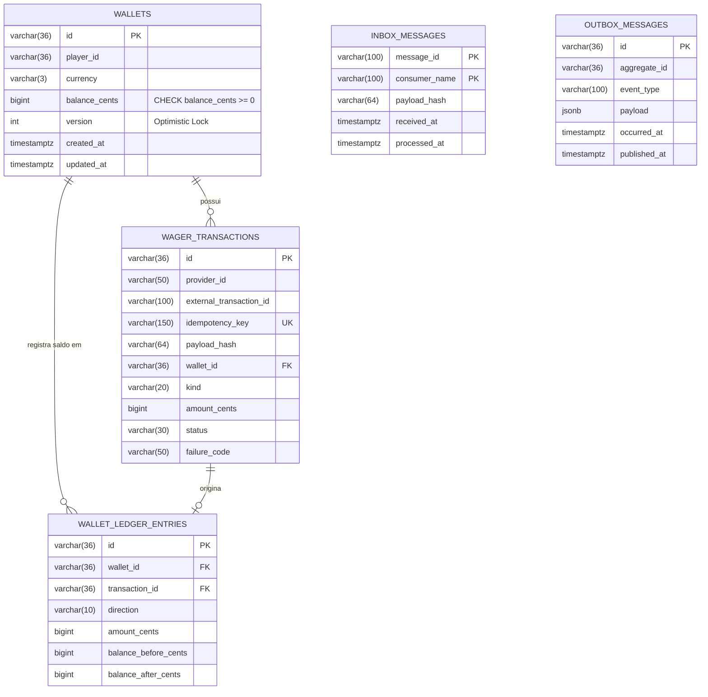

# Módulo: Mapeamento MikroORM e Migrações PostgreSQL (`src/infrastructure/database`)

---

## SEÇÃO 1: ENGENHARIA DE SOFTWARE (Technical Specification)

### 1. Visão Geral e Responsabilidade
O módulo de banco de dados baseado em **MikroORM** e **NestJS** provê o mapeamento objeto-relacional programático (`EntitySchema`), configuração de conexão transacional com o driver PostgreSQL (`@mikro-orm/postgresql`) e controle versionado e reversível de migrações (`@mikro-orm/migrations`). Sua responsabilidade única é traduzir as entidades do modelo de domínio em tabelas físicas no PostgreSQL com constraints declarativas nativas, preservando a pureza das classes de domínio sem poluição por decorators de ORM.

### 2. Motivação e Justificativa (Por que existe?)
Em Clean Architecture e DDD estrito:
* As classes de domínio (`Wallet`, `WagerTransaction`, etc.) não devem carregar decorators de frameworks (`@Entity()`, `@Column()`, `@Index()`) nem depender de tipos de ORM.
* A persistência relacional exige garantias no schema do banco que impeçam corrupção de dados mesmo sob acessos externos diretos ou concorrência descontrolada.
* O MikroORM foi selecionado pela conformidade nativa com **Unit of Work**, **Identity Map**, suporte explícito a `LockMode` (pessimista e otimista) e abstração desacoplada via `EntitySchema`.

#### Constraints Físicas e Invariantes Garantidas no Schema:
* `CONSTRAINT check_positive_balance CHECK (balance_cents >= 0)`: Impede inserção ou atualização de saldo negativo diretamente na tabela `wallets`.
* `CONSTRAINT uk_wallets_player_currency UNIQUE (player_id, currency)`: Assegura a invariante de no máximo uma carteira por jogador e moeda.
* `CONSTRAINT uk_wager_provider_external UNIQUE (provider_id, external_transaction_id)`: Bloqueia duplicidade de identificador externo por provedor na tabela `wager_transactions`.
* `CONSTRAINT uk_wager_idempotency_key UNIQUE (idempotency_key)`: Garante a unicidade global da chave de idempotência.
* `CONSTRAINT check_ledger_equation`: Valida matematicamente no banco que `balance_before ± amount === balance_after` para cada lançamento no razão.
* Chave primária composta `(message_id, consumer_name)` na tabela `inbox_messages`: Deduplicação natural por consumidor no padrão Inbox.

### 3. Detalhamento Técnico da Implementação

#### Mapeamentos de Entidades Criados
| Entidade / Schema | Tabela | Estratégia de Mapeamento | Constraints e Índices Notáveis |
|---|---|---|---|
| `WalletSchema` | `wallets` | `EntitySchema<WalletDbEntity>` | `check_positive_balance`, `uk_wallets_player_currency`, controle de versão otimista (`version: true`). |
| `WagerTransactionSchema` | `wager_transactions` | `EntitySchema<WagerTransactionDbEntity>` | `uk_wager_provider_external`, `uk_wager_idempotency_key`, índice `idx_wager_tx_pending_reference`. |
| `WalletLedgerEntrySchema` | `wallet_ledger_entries` | `EntitySchema<WalletLedgerEntryDbEntity>` | `check_ledger_equation`, FKs para `wallets` e `wager_transactions`. |
| `InboxMessageSchema` | `inbox_messages` | `EntitySchema<InboxMessageDbEntity>` | Chave primária composta `(message_id, consumer_name)`. |
| `OutboxMessageSchema` | `outbox_messages` | `EntitySchema<OutboxMessageDbEntity>` | Payload em `jsonb`, índice parcial `idx_outbox_pending_skip_locked` para `SKIP LOCKED`. |

#### Diagrama Relacional do Schema MikroORM


### 4. Alinhamento com Clean Architecture & DDD
* **Camada**: `Infrastructure Layer` (`src/infrastructure/database/`).
* **Desacoplamento do Domínio**: Os esquemas usam `EntitySchema` programático, permitindo que as entidades em `src/domain/entities/` permaneçam livres de qualquer anotação ou dependência de ORM.
* **Módulo NestJS**: O `DatabaseModule` encapsula a inicialização do MikroORM via `MikroOrmModule.forRoot(mikroOrmConfig)` e expõe os repositórios para injeção de dependência na camada de apresentação/aplicação.

---

## SEÇÃO 2: USER GUIDE & MANUAL DE OPERAÇÃO

### 1. Como Executar e Testar

```bash
# Executa os testes de validação dos esquemas e migração do MikroORM
bun test tests/infrastructure/database/mikro-orm-schema.spec.ts

# Executa todos os testes da suíte completa
bun test
```

#### Executando Migrações via CLI do MikroORM:
```bash
# Rodar as migrações pendentes no banco
bun x mikro-orm migration:up

# Reverter a última migração
bun x mikro-orm migration:down
```

### 2. Exemplo de Uso Prático (Configuração e NestJS)

```ts
import { Module } from "@nestjs/common";
import { DatabaseModule } from "./src/infrastructure/database/database.module";

@Module({
  imports: [DatabaseModule],
})
export class AppModule {}
```

Injetando o `EntityManager` do MikroORM com controle transacional e lock pessimista:

```ts
import { EntityManager, LockMode } from "@mikro-orm/core";
import { WalletDbEntity } from "./src/infrastructure/database/schemas";

async function debitWithPessimisticLock(em: EntityManager, walletId: string, amountCents: bigint) {
  return await em.transactional(async (txEm) => {
    // Bloqueio pessimista SELECT ... FOR UPDATE via LockMode do MikroORM
    const wallet = await txEm.findOne(
      "Wallet",
      { id: walletId },
      { lockMode: LockMode.PESSIMISTIC_WRITE }
    ) as WalletDbEntity;

    if (wallet.balanceCents < amountCents) {
      throw new Error("Insufficient funds");
    }

    wallet.balanceCents -= amountCents;
    // O Unit of Work persiste a alteração e atualiza o version automaticamente
  });
}
```

### 3. Guia de Resolução de Problemas (Troubleshooting)

| Erro | Causa Provável | Solução |
|---|---|---|
| `violates check constraint "check_positive_balance"` | Tentativa de atualizar `balance_cents` para valor menor que zero. | Validar o saldo antes de executar o débito. A constraint física protegeu a integridade do banco. |
| `violates unique constraint "uk_wallets_player_currency"` | Tentativa de inserir duas carteiras para o mesmo jogador com mesma moeda. | Buscar a carteira existente via `findOne({ playerId, currency })` em vez de criar duplicada. |
| `violates unique constraint "uk_wager_idempotency_key"` | Reutilização da mesma `Idempotency-Key` em nova transação. | Tratar idempotência retornando a transação original existente. |
