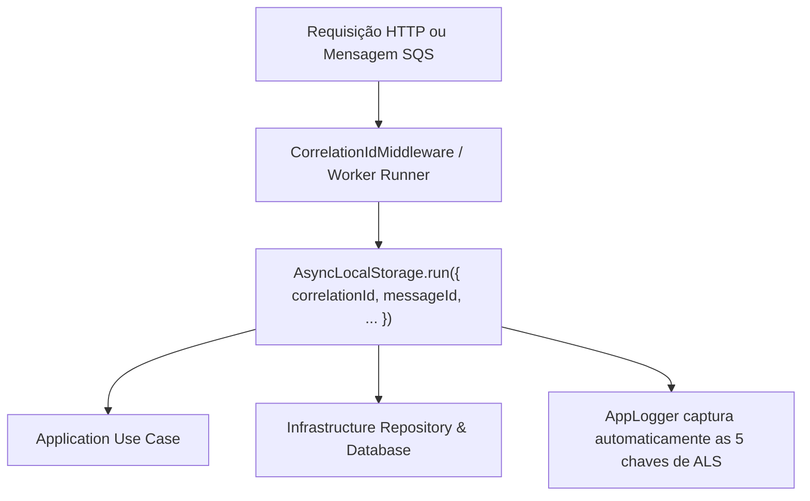

# Módulo: Observabilidade, Logging Estruturado e Telemetria (`src/infrastructure/logging`, `src/infrastructure/metrics`, `src/presentation/http/controllers/health.controller.ts`)

---

## SEÇÃO 1: ENGENHARIA DE SOFTWARE (Technical Specification)

### 1. Visão Geral e Responsabilidade

O módulo de **Observabilidade e Telemetria** provê rastreabilidade distribuída, visibilidade operacional em tempo real e monitoramento de saúde do processador financeiro distribuído (conforme Seção 12 do README oficial).

Suas principais responsabilidades incluem:

1. **Logging Estruturado em JSON puro:** Emissão de logs em linha única com formato JSON padronizado e sanitização recursiva contra vazamento de credenciais ou dados financeiros sensíveis.
2. **Propagação de Contexto Transacional via `AsyncLocalStorage` (`RequestContextService`):** Rastreabilidade fim-a-fim injetando automaticamente as 5 chaves obrigatórias em todos os eventos de log: `correlationId`, `messageId`, `transactionId`, `walletId` e `providerId`.
3. **Métricas Operacionais e Exportação OpenMetrics/Prometheus (`MetricsService`):** Contadores e histogramas cobrindo transações por status, duplicatas de idempotência, retries, mensagens em DLQ, contenções de lock, latência de processamento e lag da Transactional Outbox, expostos via `GET /metrics`.
4. **Probes de Saúde e Prontidão Aprofundados (`HealthController`):** Verificações separadas para liveness (`GET /health/live`) e readiness (`GET /health/ready`), validando ativamente a conectividade real com PostgreSQL e AWS SQS (LocalStack) sem requerer autenticação.

---

### 2. Formato e Chaves Obrigatórias de Log (`AppLogger`)

O `AppLogger` customizado implementa a interface `LoggerService` do NestJS e garante que cada linha emitida no `stdout`/`stderr` seja um JSON válido contendo a estrutura auditável canônica:

```json
{
  "timestamp": "2026-11-12T02:07:34.120Z",
  "level": "info",
  "message": "Mensagem [msg-123] processada e commitada com sucesso. ACK efetuado.",
  "context": "SqsConsumerWorker",
  "correlationId": "provider-a:transaction-123",
  "messageId": "msg-123",
  "transactionId": "transaction-123",
  "walletId": "0192f291-27dd-7d3f-8071-5f8685deef37",
  "providerId": "provider-a",
  "data": { ... }
}
```

> [!NOTE]
> Caso alguma chave de contexto não esteja presente na execução atual, o logger emite o campo com valor `null`, garantindo estabilidade no schema do parser do agregador de logs (ex: Elasticsearch, Datadog, CloudWatch).

#### Sanitizador de Payloads (`sanitizePayload`)

Para cumprir a restrição inegociável de **NUNCA vazar dados sensíveis**, o sanitizador varre recursivamente dicionários e arrays:

- Campos correspondentes a `/password/i`, `/token/i`, `/secret/i`, `/authorization/i`, `/apiKey/i`, `/privateKey/i`, `/creditCard/i`, `/cvv/i`, `/pin/i` são substituídos pelo marcador estrito `"[REDACTED]"`.
- Proteção contra referências circulares (`WeakSet`) e limite seguro de profundidade de inspeção.

---

### 3. Contexto de Rastreabilidade (`RequestContextService`)

Implementado sobre a API nativa de alta performance `AsyncLocalStorage` do Node.js/Bun:



- **HTTP:** O `CorrelationIdMiddleware` captura o header `x-correlation-id` (ou gera um novo UUIDv4) e inicializa o contexto, propagando o cabeçalho na resposta.
- **Mensageria SQS:** O `SqsConsumerWorker` encapsula o processamento em `RequestContextService.run` com `messageId`, `correlationId` (idempotencyKey), `transactionId`, `walletId` e `providerId`.
- **Transactional Outbox:** O `OutboxRelayerWorker` encapsula cada publicação em `RequestContextService.run` com `correlationId` e `transactionId` extraídos do `aggregate_id`.

---

### 4. Coletor de Métricas Operacionais (`MetricsService`)

Mapeamento de métricas essenciais exigidas pela Seção 12:

| Métrica                              | Tipo                 | Descrição                                                                                |
| :----------------------------------- | :------------------- | :--------------------------------------------------------------------------------------- |
| `transactions_total`                 | Counter              | Total de transações por status (`PROCESSED`, `REJECTED`, `FAILED`, `PENDING_REFERENCE`). |
| `idempotency_duplicates_total`       | Counter              | Total de detecções de replay ou conflito de idempotência.                                |
| `messaging_retries_total`            | Counter              | Total de retentativas executadas em workers e consumidores SQS.                          |
| `dlq_messages_total`                 | Counter              | Total de mensagens encaminhadas para Dead Letter Queue.                                  |
| `lock_contentions_total`             | Counter              | Ocorrências de espera prolongada ou colisão em locks pessimistas de carteira.            |
| `outbox_lag_seconds`                 | Summary / Histograma | Tempo decorrido entre `occurred_at` do evento e sua efetiva publicação.                  |
| `transaction_processing_duration_ms` | Summary / Histograma | Latência de processamento das transações financeiras.                                    |

- **Endpoint de Coleta:** `GET /metrics` responde com `Content-Type: text/plain; version=0.0.4; charset=utf-8` no padrão Prometheus / OpenMetrics.

---

### 5. Health Checks e Probes de Prontidão (`HealthController`)

- **`GET /health/live` (Liveness Probe):**
  - Verificação extremamente leve de vivacidade do processo.
  - Retorna HTTP 200 `{ "status": "UP", "timestamp": "..." }`.
  - Nunca bloqueia ou depende de infraestrutura externa.

- **`GET /health/ready` (Readiness Probe):**
  - Verificação aprofundada de conectividade real:
    1. **PostgreSQL:** Executa `SELECT 1` com timeout de 2 segundos.
    2. **AWS SQS / LocalStack:** Dispara comando de probing (`ListQueuesCommand`) com timeout de 2 segundos.
  - **Status HTTP 200 OK:** Quando ambos respondem com sucesso:
    ```json
    {
      "status": "UP",
      "database": "UP",
      "messaging": "UP",
      "timestamp": "2026-11-12T02:07:34.500Z"
    }
    ```
  - **Status HTTP 503 Service Unavailable:** Se o PostgreSQL ou a Mensageria estiverem inacessíveis, retorna HTTP 503 com payload detalhando qual componente falhou:
    ```json
    {
      "status": "DOWN",
      "database": "DOWN",
      "messaging": "UP",
      "timestamp": "2026-11-12T02:07:34.500Z"
    }
    ```
  - **Isenção de Autenticação:** As rotas `/health/live` e `/health/ready` são públicas e não exigem tokens ou autenticação.

---

## SEÇÃO 2: GUIA DE OPERAÇÕES E TESTES (Operations Manual)

### 1. Comandos de Verificação e Validação

```bash
# Validação estrita de tipos TypeScript (verbatimModuleSyntax)
bun run typecheck

# Execução dos testes unitários de logging e telemetria
bun test tests/infrastructure/logging/
bun test tests/infrastructure/metrics/
bun test tests/presentation/http/health.controller.spec.ts

# Execução completa da suíte de testes do projeto (154 testes)
bun test
```

### 2. Inspeção Manual das Rotas de Observabilidade

```bash
# Verificação de vivacidade (Liveness)
curl -i http://localhost:3000/health/live

# Verificação de prontidão (Readiness)
curl -i http://localhost:3000/health/ready

# Coleta de métricas no formato Prometheus
curl -i http://localhost:3000/metrics
```
